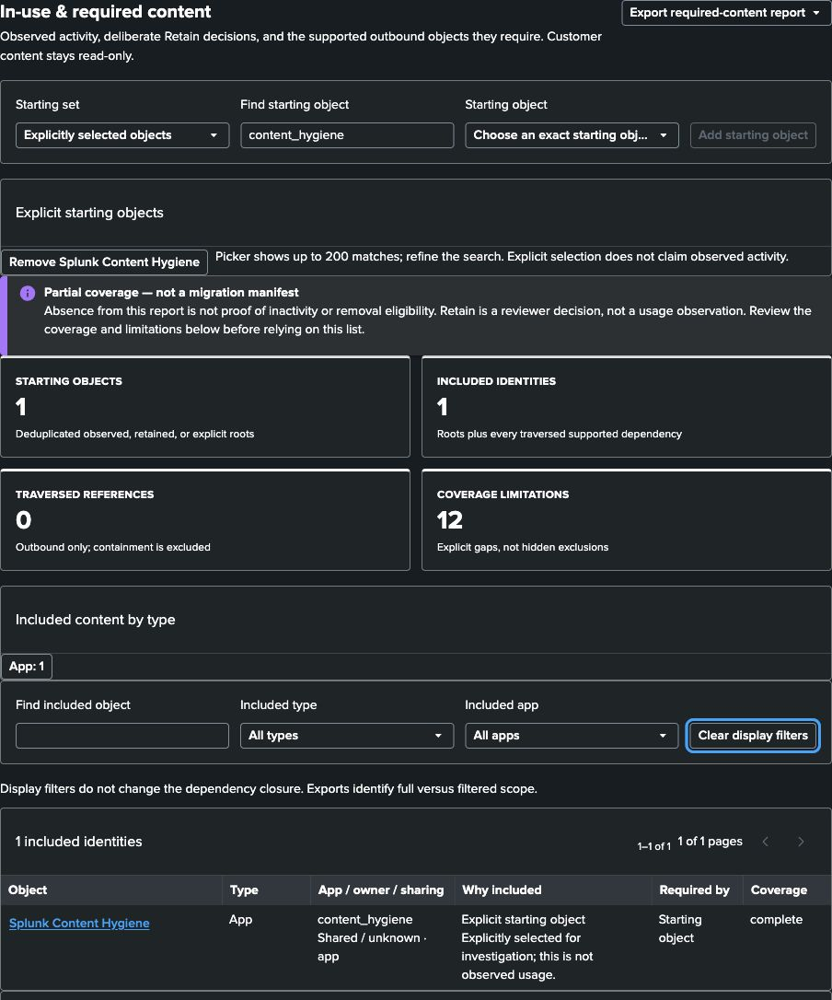
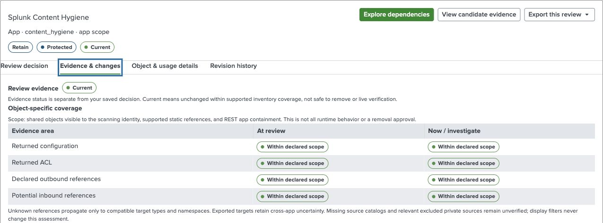
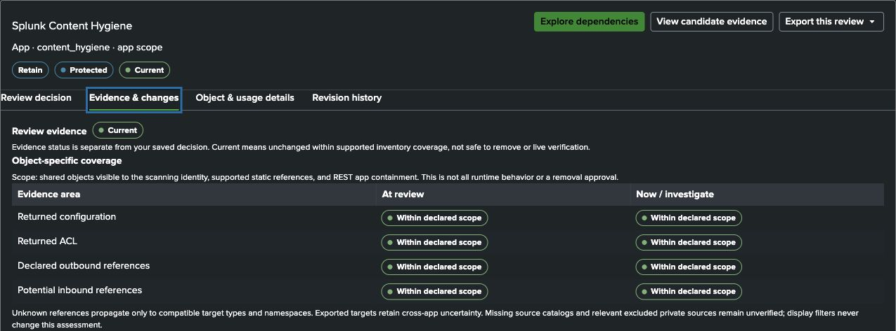
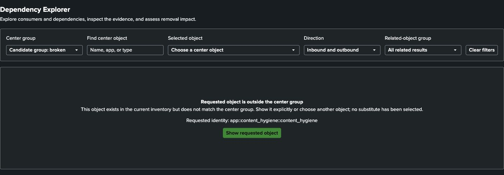
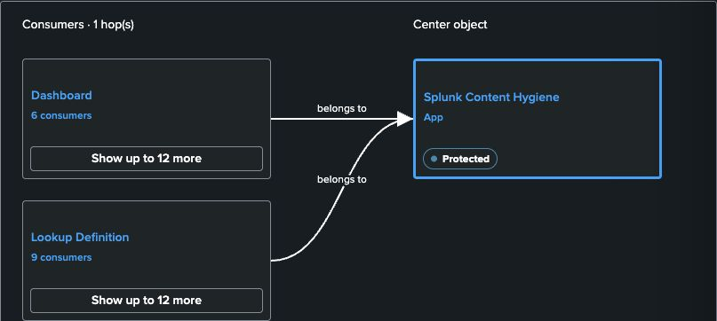

# Splunk Content Hygiene


[](https://github.com/LeiterConsulting/splunk-content-hygiene/actions/workflows/ci.yml)

Splunk Content Hygiene is an evidence-first Splunk Enterprise app for
inventorying knowledge objects, exploring dependencies, finding ownership and
repair concerns, and managing a review workflow before any separate cleanup
process begins.

The app keeps customer content read-only:

- It reads real Splunk data and never falls back to a demonstration dataset.
- It does not delete, disable, reassign, or rewrite customer content.
- It stores scan results and review workflow records only in app-local KV Store
  collections.
- Every finding carries reasons, evidence, and a suggested investigation step.

## Version 1.4.0 — declared extraction outputs

[Release 1.4.0, build 79](https://github.com/LeiterConsulting/splunk-content-hygiene/releases/tag/v1.4.0) adds bounded, names-only attribution for inline `EXTRACT-*`
captures and unambiguous search-time transform `REGEX`, literal `FORMAT` and
`DELIMS`/`FIELDS` declarations. Existing Explorer/Library details expose expandable
source locations, capture numbers and declared inputs without caching patterns
or event values. This is declared provenance, not regex execution or field
availability. Unsupported/dynamic cases remain explicit gaps.

New scans use coverage policy `shared-static-v4`; v1/v2/v3 decisions and captured
baselines remain readable and unchanged. A scan never reaffirms a decision.
Build 79 passes 680 automated checks and pre-cert AppInspect with zero
errors/failures, three reviewed warnings and one manifest skip. Native catalog/
cache and schema comparisons, targeted Light/Dark checks and 22 actual report
downloads cover Enterprise 10.2.5, 10.2.8 and 10.4.4. Original review records and
captured baselines remain unchanged. See the [qualification and limits](docs/COMPATIBILITY.md#140-extraction-output-qualification),
including emulated-VM cold-load timeouts and bounded native Library coverage.

## Version 1.3.0 — dependency accuracy

[Release 1.3.0, build 77](https://github.com/LeiterConsulting/splunk-content-hygiene/releases/tag/v1.3.0) adds shared
**Event Type** and **Tag Binding** inventory, literal inclusion/exclusion filters,
namespace-aware resolution and explicit uncertainty through investigations,
required-content reports, review freshness and CSV/JSON. Existing decisions and
their captured evidence are preserved; a coverage-policy expansion can require
explicit re-review, not automatic reaffirmation.

The bounded field-lineage increment inventories shared **Field Extraction**, **Field
Alias**, **Calculated Field** and **Field Transform** definitions. Ordered REPORT
bindings, declared field-input paths and exact event-scope callers are explicitly
potential. Existing object details show field names, phases and provenance;
reports retain the same qualifications. Customer SPL, expressions and PCRE are
never executed to infer lineage, and raw declaration bodies are not cached.

Release **build 77** passes 588 automated checks, packaging and pre-cert
AppInspect with no errors or failures (three reviewed warnings). Fresh native scans and catalog/cache
comparisons cover Enterprise **10.2.5, 10.2.8 and 10.4.4**; targeted light/dark
checks cover field facts, wrapped graph/context details and the existing review
workflow. Real CSV/JSON retains potential-path provenance and partial coverage.
Saved decisions and evidence baselines remain unchanged. Earlier candidates
73/74 qualify event/tag coverage only; they do not contain installed field coverage.
See the [compatibility scope](docs/COMPATIBILITY.md#130-dependency-accuracy-qualification)
and [field-lineage investigation guide](docs/USER_GUIDE.md#declared-field-lineage).

## What it includes

- Overview reporting for the latest live scan, including searchable, sortable,
  paginated per-app health composition
- Cleanup-candidate filtering, evidence inspection, review stages, and CSV/JSON
  export
- Bulk review of selected/page/all-filtered candidates with confirmation,
  existing-decision protection, cancellation and per-object results
- An in-use/required-content footprint grouped by type, combining current
  attributable activity and explicit Retain decisions, or following deliberately
  selected starting objects through their supported outbound dependencies
- Grouped, expandable directional dependency exploration, multi-step drill-through, candidate-group
  and review-stage filters, graph-derived removal-impact simulation, ordered
  remediation guidance, and relationship/impact export
- Native automatic-lookup rule inventory, configured lookup-definition/file
  chains, and explicitly potential caller links from exact event selectors
- Shared event-type/tag inventory and bounded declared extraction, alias,
  calculated-field and transform lineage, with exact identities and provenance
- A persistent Review Library with triage, investigation, owner-confirmation,
  eligibility, retain, and blocked stages, with independent review-evidence
  validity, scoped coverage, change explanations, explicit reaffirmation,
  conflict-safe saves, recoverable archiving, revision history, and evidence exports
- Full-width selected-object workspaces with investigation actions at the top,
  focused evidence/decision/history tabs, previous/next review navigation, and
  unsaved-draft protection
- Exact dependency targeting with explicit unavailable/filtered-out states and
  source-scan change notices instead of unrelated fallback objects
- Ownership reporting and cross-view navigation
- Bounded and complete live scans with progress, warnings, collector counts, and
  scan-report export
- On-demand 30/90/180-day usage-evidence windows for directly attributable
  saved-search executions and dashboard access, with explicit complete,
  partial, and unavailable source coverage

The complete scan inventories installed apps, saved searches, dashboards, macros,
event types, tag bindings, field extractions, aliases, calculated fields,
field transforms, automatic lookup rules, lookup definitions and files,
data models, indexes, sourcetypes, and users visible to the initiating Splunk user.
Private objects are excluded from
the shared cache; access is restricted to explicit hygiene roles.

## Install

1. Download the release archive and `SHA256SUMS` from the
   corresponding GitHub release.
2. Verify the SHA-256 digest.
3. In Splunk Web, open **Apps > Manage Apps > Install app from file** and upload
   the archive.
4. Open **Splunk Content Hygiene > Settings & Scan Status**.
5. Run a bounded scan first, then a complete scan when the permission and
   connectivity check succeeds.

The support baseline is Splunk Enterprise **10.2.5 or later** on a standalone
Linux x86-64 search head with KV Store. Release 1.4.0 **build 79** has targeted
real-data qualification on **10.2.5, 10.2.8 and 10.4.4**: fresh bounded/full scans,
native catalog/cache and schema comparisons, field/dependency investigations,
required-content and removal-impact exports, and the existing Review Library in
light/dark modes. Saved decisions and evidence baselines are preserved. This is
bounded static coverage, not execution telemetry or a large-estate benchmark.

Release 1.2.0 (build 72) adds wrapped labels, opaque
relationship surfaces, hover/focus previews and full-context dialogs. Targeted
real-data UI checks cover Enterprise 10.2.8 and 10.4.4 in both themes. The minimum
runtime evidence above is distinct from these final UI checks; see the exact
qualification scope in the compatibility policy below.

App 1.1.1 build 67 retains its broader qualification on
10.2.5, 10.2.8 and 10.4.4: all seven pages in light/dark modes, real-data scans,
filter recovery and preservation of existing decisions. Targeted native-browser
checks include actual 200% zoom, keyboard review/draft flows and operator-assisted
VoiceOver announcements. These are bounded checks, not accessibility certification.
Classic/modern navigation and native launcher icons retain their earlier runtime
qualification. Maintenance patches do not each require separate release
qualification without a known regression. See the
[compatibility policy](docs/COMPATIBILITY.md)
for the tested matrix and deployment boundaries, and
[Installation](docs/INSTALLATION.md) for upgrade and verification details.

## Investigation workflow

1. Start with a complete scan and review any partial-result warnings.
2. Collect a bounded usage-evidence window and resolve any source-coverage
   warnings.
3. Filter **Cleanup Candidates** by health group, usage evidence, app, type, or
   review stage.
4. Inspect inbound and outbound relationships in **Dependency Explorer**.
5. Add an object to **Review Library**, record evidence, assign it, and move it
   through the appropriate confirmation stage.
6. Export the filtered evidence for external review or reporting.
7. Before relying on a saved decision, check **Review evidence** and
   **Changes since review**. Investigate changes, then explicitly reaffirm the
   evidence; scans never overwrite your decision.

Coverage separates returned configuration, returned ACL, declared outbound
references, and potential inbound references. **Current** means the supported
shared static scope matches a recent reviewed baseline—not that no hidden,
private, dynamic, or external consumer exists. Removal-impact planning retains
its wider, conservative blockers.

After upgrading to 1.4, run a complete scan to collect output attribution and
the expanded shared event/tag and field catalogs alongside automatic lookup rules. Follow configured
definitions and declared field paths in Explorer. **May apply**, **may read** and
**may use** links remain explicitly potential through
multi-hop reports, impact explanations and exports. New evidence may require
re-review; the scan does not change your saved decision or reaffirm its baseline.

Concurrent saves cannot silently replace one another. A conflicting editor keeps
its draft and offers comparison with the latest saved revision. Archiving removes
only the active Library entry; its decision and revision history remain available.

## Screenshots

The 1.1 required-content report keeps explicit selections separate from observed
activity and Retain decisions. This capture starts from Content Hygiene's own
application metadata: an App is not an app-wide retain rule, so containment does
not expand its footprint. The partial-coverage warning remains visible.



[Light-mode report capture](docs/images/required-content-light.jpg) starts from
the app's own Dependency Explorer dashboard through its **Required content report**
action; neither capture uses demo data.

Bulk review uses a native decision editor, followed by an exact-scope confirmation
and per-object results. See the [bulk-review workflow](docs/USER_GUIDE.md#bulk-candidate-review)
for scope, conflict, cancellation, and export behavior.

The 1.0.1 Review Library gives a selected object the full workspace width,
places investigation actions beside its title, and separates decisions,
evidence, object details, and history into native tabs. These real-data captures
show Content Hygiene's own application metadata; customer content, user identity,
and lab navigation are excluded. **Current** compares a captured inventory
snapshot with the reviewed baseline, not live content or removal eligibility.





Dependency links retain the exact requested identity. A center-group mismatch
offers explicit recovery instead of silently showing another object. This
capture uses the app's own protected metadata, outside the broken-candidate group.



The directional map groups the app's real dashboard and lookup consumers by
type, with on-demand expansion and a full evidence table alongside the map.



“Confirmed eligible” is an investigation conclusion, not an action. Removal or
remediation remains outside this app.

## Documentation

- [User guide](docs/USER_GUIDE.md)
- [Installation](docs/INSTALLATION.md)
- [Compatibility and minimum-version policy](docs/COMPATIBILITY.md)
- [Administration](docs/ADMINISTRATION.md)
- [Troubleshooting](docs/TROUBLESHOOTING.md)
- [Architecture and data flow](docs/ARCHITECTURE.md)
- [Branding and native navigation](docs/BRANDING.md)
- [Data model](docs/DATA_MODEL.md)
- [Development and testing](docs/DEVELOPMENT.md)
- [Release process](docs/RELEASE.md)
- [Support](SUPPORT.md)
- [Security policy](SECURITY.md)

## Build from source

Node.js 22 or newer and Yarn 1.22 are required.

```bash
cd app
yarn install --frozen-lockfile
yarn validate
```

The verified installable archive is written to
`app/dist/content_hygiene-<VERSION>.tar.gz` (currently 1.4.0, build 79).
Run `yarn release:prepare` to
perform the complete validation and update `SHA256SUMS`.

## Current limitations

- The required-content report is a partial shared static footprint, not a complete
  migration manifest. Automatic lookup callers are possible exact event-scope
  matches, not observed use. Pattern scopes, other implicit props, uninventoried
  types, private/dynamic content and ad-hoc consumers remain explicit gaps. See
  [automatic lookup investigations](docs/USER_GUIDE.md#automatic-lookups-and-implicit-props).
- Declared field-lineage paths do not establish effective values or runtime
  use. Capture attribution is a bounded names-only subset, not PCRE compilation
  or matching. Unsupported/dynamic outputs and expressions, cross-scope
  precedence, alias chaining and EVAL-to-EVAL chaining remain unverified.
- Bulk review is not atomic or an app-wide retain rule. Existing decisions are
  skipped by default; completed saves remain if later items fail or are cancelled.
- Scans run in the initiating browser session and are not scheduled.
- Each complete-scan collector is capped at 10,000 visible records and reports
  truncation.
- Usage evidence is limited to saved-search and dashboard activity directly
  attributable through `_audit` and `splunk_web_access` records visible to the
  initiating user. Retention, permissions, and unmappable private namespaces
  are reported rather than treated as inactivity.
- Dynamic SPL and token references are disclosed but not resolved as broken.
- Inline dashboard panels are analyzed through their parent dashboard.
- Review history is application history, not a tamper-proof audit. Authorized
  direct KV access can alter it. App saves use a server-side coordinator;
  coordinated writes require a standalone POSIX search head, not SHC or Windows.
- Journal history grows with accepted edits. Library loading reads compact
  revision headers and the required decision/evidence documents; history details
  load in pages. Plan KV capacity and backups for your review volume.

## License

Licensed under the [MIT License](LICENSE). Copyright © 2026 Leiter Consulting.
